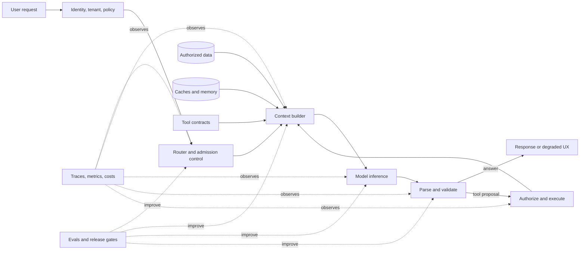
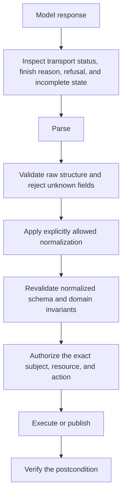

# Production AI Engineering Field Guide

Last evidence review: **2026-08-31**

Production AI engineering works as a system. This handbook lays out an operating model that connects the techniques instead of treating them as isolated fixes. The central idea is simple:

> A model can propose an answer or action. The surrounding system decides whether and how it should proceed, and remains responsible for the outcome.

Optimize for a **successful, policy-compliant user outcome that meets service-level objectives (SLOs) for latency and cost**. A prompt or model call is only one part of that outcome.

## 1. The full system



Each layer has a specific job:

| Layer | Primary responsibility | Typical failure |
|---|---|---|
| Product contract | Define success, SLOs, risk, and degraded behavior | Optimizing a proxy that users do not value |
| Harness | Orchestrate state, tools, retries, budgets, and termination | Runaway loops or duplicate side effects |
| Context | Select the smallest high-signal authorized state for this step | Context rot, stale facts, or contamination |
| Retrieval and memory | Supply current, attributable external knowledge | Irrelevant, stale, or unauthorized evidence |
| Model and serving | Produce useful tokens efficiently | Queueing, KV pressure, or quality loss |
| Validation and policy | Turn probabilistic proposals into safe actions | Valid JSON with invalid business meaning |
| Evals and observability | Detect regressions and explain production behavior | Silent quality, cost, or safety drift |

## 2. Harness engineering, not just prompt engineering

Prompt engineering handles the wording and structure of instructions. Context engineering selects and maintains every token supplied for each model step. Harness engineering runs the software system around the model.

| Discipline | Controls | It does not control by itself |
|---|---|---|
| Prompt engineering | Instruction clarity, examples, response guidance | State, permissions, retries, side effects |
| Context engineering | Instructions, history, retrieved evidence, tool definitions, summaries, token allocation | Execution safety or end-to-end termination |
| Harness engineering | State machine, routing, tools, validators, budgets, caches, telemetry, recovery | The model's intrinsic capability ceiling |

A production harness needs to own:

1. **Bind every run.**
   1. Request identity, tenant, authorization, and policy version.
   2. Prompt, tool, schema, model, and retrieval-index versions.
2. **Control execution.**
   1. Deterministic context assembly and compaction.
   2. Model routing and fallback compatibility.
   3. Parse, schema, semantic, and policy validation.
   4. Retry classification and idempotency.
3. **Bound and account for outcomes.**
   1. Time, token, tool, turn, cost, and risk budgets.
   2. Success, refusal, blocked, degraded, and failed terminal states.
   3. Traces, outcome metrics, and cost attribution.

Enforce any rule about safety, money, permissions, or termination in code. A sentence in a system prompt can steer the model, but it cannot serve as a security boundary.

## 3. Context engineering, not long prompts

Treat context as finite working memory with diminishing marginal value. Adding more can increase prefill cost and time while drawing effective attention away from the material that matters. A long context window does not justify loading everything into it.

Build the context in this order:

1. **Invariant contract:** role, hard policies, output/tool protocol, and current schema version.
2. **Current task:** the user's latest intent and explicit constraints.
3. **Authorized state:** only the tenant, resource, and conversation state needed now.
4. **Fresh evidence:** retrieved passages with source, version, timestamp, and access metadata.
5. **Available actions:** only relevant, clearly distinct tool contracts.
6. **Useful history:** compact decisions and unresolved state, not an unfiltered transcript.
7. **Examples:** only when they improve the target eval more than the tokens and anchoring risk cost.

Practical rules:

- Optimize **signal per token**, not context-window utilization.
- Retrieve details just in time. Keep durable decisions in explicit state.
- Label and separate untrusted content from instructions, but do not mistake roles, delimiters, or typed fields for isolation. Enforce a deterministic source-to-sink policy so data derived from an untrusted source cannot authorize actions, expand permissions, or select new egress destinations.
- Keep provenance attached through summarization. A summary without its source and version creates a future stale-fact bug.
- Use structured state instead of repeatedly asking the model to infer state from prose.
- Give tools concise, non-overlapping names and descriptions. Expose only the tools relevant to the current step.
- Version and hash the context manifest so the team can reproduce a bad result.
- Test context ordering and truncation. Models can use relevant information less reliably when it is buried in a long input, a behavior documented by the [Lost in the Middle](https://aclanthology.org/2024.tacl-1.9/) study.

Treat a token budget as a policy, not a universal percentage. One practical version looks like this:

```key-value
fixed contract      hard cap; cache-friendly prefix
task and state      enough to make the current decision
retrieved evidence  top-ranked, deduplicated, attributable
tool definitions    relevant tools only
working history     compacted decisions and open questions
output reserve      protected before adding more input
```

When the budget gets tight, remove redundant and low-confidence material first. Compress authoritative instructions or evidence only after those cuts.

## 4. Four caches that must not be confused

| Cache | Key and value | Main benefit | Main risk | Invalidation/isolation |
|---|---|---|---|---|
| Exact response cache | Exact normalized request to completed response | Avoids the entire workflow | Stale response if hidden state changed | Include every response-affecting version and authorization dimension |
| Prompt/prefix cache | Exact rendered-token prefix to reusable prefill work | Can lower TTFT and billed input cost when read/write pricing and reuse frequency are favorable | Small serialization changes destroy hits; provider write pricing and retention implications | Stable prefix first; model/prompt scoped; follow provider data controls |
| Semantic response cache | Embedding-near request to prior response | Captures paraphrases and reduces full calls | False positive can return a plausible but wrong, stale, or unauthorized answer | Tenant/principal, state, model, prompt, corpus, policy, locale, and freshness scoped |
| Runtime KV cache | Per-layer attention keys and values for an active sequence | Avoids recomputing tokens already processed within that sequence | GPU memory exhaustion and cross-request leakage if ownership is mishandled | Request ownership, active block pinning, preemption, reclamation, and quotas |

Prompt caching and semantic caching do different work:

- **Prompt/prefix caching is exact and reuses prefill work.** It skips recomputation for an identical rendered prefix, while still running prefill for the uncached suffix and a full decode. Put stable system instructions, examples, and tool definitions first. Put user-specific material later. Small differences in tokenization, message order, tool serialization, or timestamps can destroy a hit. The cache can reduce TTFT and billed input cost only when provider-specific read/write pricing and reuse frequency make the tradeoff worthwhile.
- **Semantic caching is approximate and reuses an answer.** It decides whether a new request is close enough to an old one to return the old answer. The reuse decision acts as both a quality classifier and a security classifier. The critical metric is **false-hit rate by risk slice**, not hit rate alone.

Use semantic caching only when two paraphrased requests should receive the same answer. Avoid it, or require verification, for personalized, permission-sensitive, rapidly changing, transactional, high-stakes, and multi-turn-dependent answers. Azure's own semantic-cache policy warns that similarity hits can be incorrect, outdated, or unsafe; see the [official policy reference](https://learn.microsoft.com/en-us/azure/api-management/llm-semantic-cache-lookup-policy).

A defensible application cache key or namespace usually needs:

```cache-key
Request scope | tenant + principal/ACL scope + task type + normalized state
Runtime contract | model snapshot + prompt version + tool-contract version + output-schema version
Policy | safety-policy version
Retrieval context | retrieval corpus/index version + locale + freshness window
```

Track cache and token hit rates; false-hit, stale-hit, and eviction rates; cache age; latency and cost saved; and cross-scope rejection count. Never share private semantic responses globally based on embedding similarity.

## 5. Prefill and decode optimize differently

Autoregressive inference has two phases that place different demands on the system.

| Property | Prefill | Decode |
|---|---|---|
| Work | Process all input tokens and populate KV state | Generate one next token per active sequence per step |
| Parallelism | High within the prompt; large matrix operations | Sequential across output positions; smaller per-step operations |
| Common bottleneck | Usually compute-bound once prompt length or batch reaches accelerator saturation | Usually weight/KV-bandwidth-bound at low-to-moderate batch; can become compute-bound at high batch |
| User metric | Prefill contributes to TTFT, which also includes queueing, retrieval, cache, and network time | Decode cadence contributes to mean TPOT and the distribution of inter-token latencies and stalls |
| Helpful techniques | Safe context reduction, prefix cache, efficient kernels, prefill batching, chunking, or disaggregation | Continuous batching, efficient kernels, quantization, speculative decoding |

Break the latency budget into its actual components:

```latency-budget
End-to-end latency
Before generation | queue + cache lookup + retrieval + rerank
Generation and execution | prefill + decode + tools + validation and retries
```

Track p50, p95, and p99 for end-to-end latency, queue time, TTFT, TPOT/ITL, and tool latency. A low average can still hide an unusable tail.

Chunked prefill can reduce interference with active decodes and improve tail inter-token latency, but it can also increase TTFT for the long prompt being split. Use prefill/decode disaggregation only when its SLO benefit outweighs the cost of duplicated model weights, KV transfer, interconnect, routing, and operations.

## 6. KV cache management and memory pressure

For a conventional transformer, use this approximation for KV footprint per sequence:

```kv-footprint
KV bytes
2 | keys and values
layers
tokens
KV heads
head dimension
bytes per element
```

Grouped-query or multi-query attention reduces `KV_heads`, which can dramatically reduce the footprint. For example, 80 layers, 8 KV heads, head dimension 128, and BF16 state use about 320 KiB per token, or roughly 10 GiB for a 32K-token sequence. Exact layouts and engine overhead vary. The scaling behavior does not: tokens, concurrency, and precision multiply.

Watch for memory pressure in:

- rising KV utilization and allocation failures;
- evictions, preemption, recomputation, or CPU offload;
- falling prefix-cache hit rate under churn;
- queue growth even when compute looks underutilized;
- throughput cliffs and out-of-memory failures on long-tail prompts;
- one tenant's long contexts starving other tenants.

Apply the controls in this order:

1. Enforce admission control and explicit maximum input/output lengths.
2. Reserve memory for active decodes and protect latency-critical traffic classes.
3. Use paged/block allocation to reduce fragmentation. Prefix sharing is a separate, explicitly keyed capability layered on top.
4. Use per-tenant concurrency and KV quotas.
5. Where prefix caching is enabled, reuse exact full-prefix blocks with ownership, refcounts, and copy-on-write semantics.
6. Evict only refcount-zero reusable blocks. Reclaim active KV by preempting whole sequences and explicitly choosing recomputation or offload; do not apply eviction only by request age without workload evidence.
7. Evaluate KV quantization or offload on long-context quality and tail latency before enabling it.
8. Shed or degrade load before allowing a node-wide OOM.

The [PagedAttention paper](https://arxiv.org/abs/2309.06180) applies virtual-memory-like block management to KV state, reducing allocation waste and enabling sharing. Paging manages memory more efficiently, but the underlying KV capacity limit remains.

For bursty multi-tenant traffic, evaluate a reservation policy against real prompt-length, output-length, and arrival traces instead of reserving each request's maximum possible KV footprint. A robust policy can admit more useful work by protecting against plausible distribution shifts while keeping an explicit overload path. Cheng et al.'s [robust KV-cache reservation study](https://arxiv.org/abs/2607.16892) provides one trace-driven formulation; it is a planning method, not a substitute for per-tenant quotas, active-decode reserves, or load shedding.

## 7. Continuous batching, paged attention, and goodput

Static batching waits for a fixed group of requests. Continuous, or iteration-level, batching releases completed sequences at each engine iteration and may admit queued work into the capacity they free, subject to token, KV, deadline, and fairness limits. The approach removes static-batch head-of-line blocking, although requests can still queue. The [Orca paper](https://www.usenix.org/conference/osdi22/presentation/yu) established iteration-level scheduling as a core serving technique.

Large prefills can still stall active decodes. Chunked prefill splits prompt processing into schedulable pieces and interleaves those pieces with decode work. The tradeoff is lower decode interference and potentially longer TTFT for the split request. [Sarathi-Serve](https://www.usenix.org/conference/osdi24/presentation/agrawal) analyzes this prefill/decode interference and stall-free scheduling.

The scheduler needs controls for:

- maximum batched tokens and active sequences;
- prefill chunk size and prefill/decode priority;
- request class, deadline, and fairness policy;
- maximum model length and output reservation;
- prefix locality and cache-aware routing;
- preemption and load-shedding policy.

Raw tokens per second do not tell you whether the service works for users. Optimize **goodput**: the maximum arrival rate per provisioned GPU or resource at which the required fraction of requests satisfies both TTFT and TPOT/ITL SLOs plus the application-quality gate. A larger batch can increase throughput while pushing interactive latency past an acceptable limit.

For multi-stage agent workflows, measure task-level completion time alongside request goodput and prefix-hit rate. Evaluate dependency and critical-path progress, prefix residency, transition and preemption cost, and starvation on real traces. Optimizing prefix locality or the progress of one stage in isolation can make the complete workflow slower.

The current [vLLM documentation](https://docs.vllm.ai/en/latest/) is a useful implementation reference for PagedAttention, continuous batching, prefix caching, chunked prefill, quantization, and speculative decoding. Engine defaults are starting points. Tune them against production prompt-length and output-length distributions.

## 8. Speculative decoding, quantization, and distillation

Speculative decoding, quantization, and distillation change different parts of the inference stack and solve different bottlenecks.

| Technique | Changes | Best fit | Main tradeoff |
|---|---|---|---|
| Speculative decoding | A draft process proposes tokens; the target verifies several in parallel | Decode-bound, low-to-moderate batch workloads with high draft acceptance | Extra draft compute and memory can erase gains when acceptance is low |
| Quantization | Represents weights and sometimes activations/KV with fewer bits | Memory/bandwidth-constrained inference with supported kernels | Calibration and numerical error can cause task-specific tail regressions |
| Distillation | Trains a smaller student to imitate a larger teacher | Stable, narrow, high-volume tasks with governed training data and clear evals | Up-front teacher-data/training cost; broad and long-tail capabilities or teacher biases can transfer or regress |

When the rejection sampler and target-model sampling semantics are implemented correctly, speculative decoding preserves the target distribution. Use it to reduce latency, not to approximate an answer. Floating-point or batching nondeterminism still prevents any guarantee of byte-identical runs. Benchmark acceptance, draft and verification cost, TPOT, and SLO goodput at production concurrency. Low acceptance or saturated compute can make the system slower. See [Leviathan et al.](https://proceedings.mlr.press/v202/leviathan23a.html).

Distillation changes the deployed model and usually changes its behavior. Distillation can greatly lower steady-state cost, but the target workflow first needs to be stable enough for teacher data and evals to represent production. [Hinton, Vinyals, and Dean](https://arxiv.org/abs/1503.02531) describe the foundational method.

## 9. Quantization: formats, methods, and quality risk

AWQ and GPTQ describe quantization methods. Numeric formats are a separate choice. Always spell out the precision tuple: `W8A8`, `W8A16`, `W4A16`, or `KV8`, for example. `INT8` and `INT4` leave too much unspecified on their own.

Weight storage is approximately `parameters × bits / 8 + scales + zero-points + unquantized modules`. W4A16 reduces weight storage, but it does not shrink activations or KV. Calling a model “4-bit” therefore does not imply 4× lower total VRAM. Whether smaller storage lowers latency depends on the actual kernel and hardware.

| Choice | What it usually means | When it is attractive | Watch for |
|---|---|---|---|
| INT8 | Integer 8-bit weights and possibly activations | Broad hardware support; safer first step from FP16/BF16 | Activation outliers, calibration mismatch, unsupported fast paths |
| FP8 | 8-bit floating point, commonly E4M3/E5M2 with scaling | Newer accelerators; training or W8A8-style inference where dynamic range matters | Hardware dependence, scale management, accumulation precision |
| INT4 | Often W4A16 weight-only, though W4A8/W4A4 also exist | Model fit and bandwidth-bound decode; native low-activation kernels may also help prefill or high batch | Greater quality risk, scale/dequantization overhead, and runtime- and hardware-dependent speedups |
| AWQ | Activation-aware weight-only post-training quantization | Protecting salient weight channels without retraining | Representative activation calibration and kernel compatibility |
| GPTQ | One-shot weight quantization using approximate second-order information | Accurate 3/4-bit compression of supported decoder models | Calibration set, group size, layer sensitivity, conversion/runtime support |

Primary references: [FP8 formats](https://arxiv.org/abs/2209.05433), [SmoothQuant for W8A8](https://proceedings.mlr.press/v202/xiao23c.html), [AWQ](https://proceedings.mlsys.org/paper_files/paper/2024/hash/42a452cbafa9dd64e9ba4aa95cc1ef21-Abstract-Conference.html), and [GPTQ](https://arxiv.org/abs/2210.17323).

Quality risk generally rises below 4-bit, in smaller models, on harder reasoning slices, with unrepresentative calibration, and when activation or KV outliers are aggressively quantized. The risk pattern is empirical, not guaranteed. Specific risks include:

- calibration data does not match production languages, domains, lengths, or modalities;
- the task depends on small logit margins, exact numbers, code, rare tokens, or precise tool arguments;
- activation or KV outliers are aggressively quantized;
- long-context, multilingual, rare-token, safety, or tool-use behavior is more sensitive than the aggregate benchmark suggests.

Short-context or aggregate-only evals can hide regressions. Missing native kernels can erase the performance gain even when quality holds. Benchmark the exact checkpoint, packing, runtime, hardware, batch shape, and parallelism plan.

Run every quantized candidate through the same golden and adversarial suite as the baseline. Include exact structured output, function selection and arguments, safety refusals, multilingual slices, long context, and p95/p99 latency. Measure end-to-end performance. Model file size alone proves nothing.

## 10. Structured outputs: syntax is only the first gate

Constrained decoding and provider structured-output features can greatly improve syntactic conformance. Syntactic conformance does not establish whether the values are true, authorized, internally consistent, current, or safe to execute.

Use this pipeline:



Build the schema so failures are explicit:

- Version the schema and reject unknown versions.
- Use required fields, enums, ranges, string formats, and `additionalProperties: false` where appropriate.
- Make invalid states hard to represent with discriminated unions rather than nullable field combinations.
- Distinguish `null`, omitted, unknown, and refused.
- Validate dates, identifiers, money, units, and cross-field relationships in deterministic code.
- Store hashes, versioned references, validation errors, and repair lineage by default. Retain raw candidates only under an explicit privacy policy with minimization or redaction, encryption, restricted access, and short retention.
- Treat schemas from providers, tool servers, or user-controlled sources as untrusted input. Do not automatically resolve network `$ref` targets. If remote resolution is explicitly enabled, allowlist hosts; block loopback, link-local, and private ranges; cap bytes and time; log every fetch; and reject unresolved references. Bound schema depth, subschema count, and validation time so composition keywords cannot turn validation into an SSRF or denial-of-service path.

Keep repair bounded:

1. Classify transport/status, refusal, incomplete/truncated, parse, schema, semantic, authorization, and policy failures separately.
2. Repair only bounded syntax or shape failures when the result is non-consequential or read-only. Never use repair to override a refusal, invent semantically missing values, or make a mutation executable.
3. Revalidate the complete normalized payload from the beginning.
4. For consequential payloads, regenerate from trusted inputs, request clarification, require review, or fail safely. Alternate models must satisfy the same data policy and contract; deterministic defaults must be explicitly product-defined and surfaced to the user.

Do not create an unbounded “please fix the JSON” loop. Track first-pass validity and final validity separately. Otherwise repair can hide a model regression. See the [OpenAI structured output guide](https://developers.openai.com/api/docs/guides/structured-outputs) and the [JSON Schema documentation](https://json-schema.org/learn/getting-started-step-by-step).

## 11. Reliable function and tool calling

Treat a tool call as an untrusted proposal crossing from a probabilistic system into deterministic software.

A strong tool contract includes:

1. one clear purpose and a distinct, namespaced name;
2. typed, unambiguous arguments such as `customer_id`, not `customer`;
3. a strict input schema and documented semantic invariants;
4. explicit read/write, destructive, network, and open-world declarations for UX and discovery; make security decisions from a trusted server-side policy registry, not annotations supplied by a dynamic or untrusted tool server;
5. bounded pagination and concise high-signal output;
6. stable error codes, `retryable` status, and a typed result envelope;
7. timeouts, rate limits, authorization requirements, and audit semantics;
8. a contract version and compatibility policy.

The harness then enforces the contract:

1. Reject unknown tool names; never dynamically dispatch a hallucinated string.
2. Parse and validate all arguments.
3. Resolve identity and authorize the exact resource and action server-side.
4. Create or accept one idempotency key per logical mutation before first dispatch. Scope it to tenant, actor, and operation; persist it across retries, resumes, handoffs, and model/provider fallbacks; reject reuse with a different normalized request fingerprint.
5. Require a single-use, expiring approval for consequential actions, bound to the normalized action, actor, resource, destination, disclosed data, and state version. Reauthorize immediately before execution; any material change requires new approval.
6. Execute with least-privilege, short-lived credentials.
7. Validate tool output and treat returned text as untrusted data, not new instructions.
8. Retry only failures known to be safe, using the same idempotency key.
9. Record the proposed action, policy decision, execution result, and resulting state.

A useful response envelope is:

```json
{
  "ok": false,
  "code": "VERSION_CONFLICT",
  "retryable": false,
  "recovery": "REFRESH_STATE_AND_REPLAN",
  "data": null,
  "state_version": "42"
}
```

Design for at-least-once delivery. Control it with idempotent effects, uniqueness constraints, or compare-and-swap state. Atomically record the idempotency key, normalized request fingerprint, side effect, and resulting receipt/state.

When a stable, repeated procedure is narrow enough to specify and test, compile it into a versioned deterministic tool instead of making the model re-reason through every mechanical step. Keep judgment, exception handling, and stop decisions explicit. In a production alarm-triage study, Kujanpaa et al. [compiled repeated SOP steps into tools](https://arxiv.org/abs/2607.08010) and reported lower median latency and fewer errors in that workflow; treat the result as domain evidence, not a universal performance guarantee.

A network timeout can leave the execution status unknown. Reconcile through the idempotency receipt or authoritative external state before retrying or changing routes. The HTTP specification explains why automatic retry is safe only when the semantics are idempotent or the client knows the original action was not applied; see [RFC 9110](https://www.rfc-editor.org/rfc/rfc9110.html#name-idempotent-methods).

Evaluate tool and protocol behavior directly. Test correct selection, correct non-selection, argument validity, authorization denial, duplicate delivery, timeout-after-commit, partial failure, hostile tool output, protocol-version negotiation, and session-state assumptions. Anthropic's [tool design guidance](https://www.anthropic.com/engineering/writing-tools-for-agents) is a useful primary reference.

Give every agent and workload a distinct identity; never lend it a human credential or allow it to impersonate the delegating user. Bind short-lived, audience-restricted authority to the operating principal, attenuate it at every delegation, and let the least-authorized hop bound the chain.

Protocol migrations are architecture migrations. MCP 2026-07-28 removed protocol sessions, `Mcp-Session-Id`, and the initialization handshake. A connection or stdio process is not a conversation: carry protocol version and capabilities on every request, discover server support before selection, and pass cross-call state through explicit handles. Treat `clientInfo` and `serverInfo` as self-reported diagnostics, never authenticated identity or policy input.

Model protocol results as a state machine. `resultType: "input_required"` is nonterminal; preserve the logical operation, policy decision, approval scope, and budget across the next round. If a response stream breaks, issue a new protocol request ID, but preserve the application idempotency key and reconcile external state before repeating a mutation. Pin the protocol and SDK, test mixed-version clients and servers, and roll through a compatibility window.

Treat protocol deprecations as owned migration work, not optional cleanup. The MCP [2026-07-28 changelog](https://modelcontextprotocol.io/specification/2026-07-28/changelog) marks Roots, Sampling, Logging, HTTP+SSE, the `"thisServer"` and `"allServers"` `includeContext` values, and OAuth Dynamic Client Registration as Deprecated. Do not add new dependencies on them. Inventory current use, assign an owner and removal date, and test the named replacement before the compatibility window closes.

## 12. Agent guardrails, budgets, and termination

An agent is a state machine whose next transition is proposed by a model. Apply guardrails at every transition. Final-text checks alone are not enough.

Enforce these budgets outside the model:

| Budget | Example control |
|---|---|
| Turns | Maximum model decisions per run |
| Tools | Total calls plus lower limits for writes or expensive tools |
| Tokens | Input, output, reasoning, and cumulative context ceilings |
| Time | Wall-clock deadline and per-step timeout |
| Cost | Hard run limit and softer escalation threshold |
| Retries | Per operation, per failure class, and total |
| Risk | Maximum unapproved action class or data scope |
| Concurrency/fan-out | Maximum in-flight model, tool, and subagent work; reserve budget before dispatch |
| Mutations | Separate count, value, and data-scope caps for writes and destructive actions |
| No progress | Stop after repeated equivalent state/action cycles |

Budget counters need to be hierarchical, atomic, and persistent across retries, resumes, handoffs, fallbacks, and subagents. A retry or alternate route must not reset the run's deadline, cost, risk, or mutation budget.

Give every run explicit terminal conditions:

- success predicate verified against external state;
- user cancellation, after stopping new work and reconciling any already-dispatched mutation whose commit status is unknown;
- policy or authorization denial;
- dependency unavailable or irrecoverably blocked;
- budget exhausted;
- repeated state, repeated action, or no measurable progress;
- insufficient evidence under an externally measured sufficiency check, or a calibrated product score that requires abstention; never use the model's self-reported confidence alone.

Broken or impossible tasks must terminate safely; persistence or additional reasoning may not unlock wider tools, egress, or credentials. Define severity triggers for boundary circumvention and unauthorized cross-agent coordination, provide a reliable fleet or workload kill path, name the authority to pause, contain, restart, and restore, and fail closed when a severe alert cannot be cleared.

Treat `awaiting_input` and `awaiting_approval` as persisted, resumable interrupts rather than success or failure terminals. Keep their deadlines and reserved budgets explicit.

The model's claim that it finished does not count as the success predicate. Verify the outcome: the record exists, tests pass, the message was sent once, or the cited evidence supports the answer.

When the run ends, return a typed state such as `succeeded`, `partial`, `blocked`, `refused`, `cancelled`, `budget_exhausted`, or `failed`. Include the completed work and a safe next action. A typed result makes degraded UX and operations much clearer than a generic error.

## 13. Model routing and degraded mode

Route against measured task requirements. Provider reputation or prompt length alone is not enough. Useful routing features include:

- task class and required capability;
- risk and consequence of error;
- modality, context length, language, and tool requirements;
- latency deadline and cost ceiling;
- tenant policy and data residency;
- current provider health and rate limits;
- router confidence and out-of-distribution detection.

Maintain a compatibility matrix for every route: exact model snapshot or negotiated protocol version; provider API, client SDK, and serving-runtime versions; lifecycle state and retirement date; supported request parameters and turn rules; tool protocol; JSON Schema support; context and output limits; refusal semantics; modality; processing geography and data policy; and tested quality slices. Treat aliases, defaults, and wrappers as mutable. Google, Anthropic, OpenAI, and AWS publish changes on different schedules, and platform-specific retirement dates can differ from a model creator's dates. A fallback that cannot honor the same contract puts the product in a different mode.

Treat provider SDK upgrades as production migrations. Diff request headers and response types, exercise every mutating method against disposable state, and canary the pinned upgrade before rollout.

Choose the fallback based on the failure class. Never route around a safety refusal, an authorization or policy denial, or a semantic validation failure. After a timeout that may have committed a mutation, reconcile through the idempotency receipt before retrying or changing routes. Every attempt shares one deadline and retry budget. Use circuit breakers to prevent retry and fallback storms.

A safe chain might be:

```fallback-flow
Primary qualified model
Compatible secondary provider/model
Smaller read-only or lower-capability mode
Terminal options | Deterministic result | Queued work | Human handoff
```

In degraded mode, tell the user exactly what changed: unavailable capability, reduced freshness, partial scope, read-only behavior, or delayed completion. Do not silently swap to a materially weaker model and present the output as equivalent.

Evaluate the router directly: route accuracy, unnecessary escalation, unsafe down-routing, fallback success, quality by route, added latency, and cost per successful task. Shadow new routing policies only on eligible, authorized traffic. Disable all side effects, redact where possible, and never send data to a provider or region outside the request's approved residency and retention policy.

## 14. RAG architecture

RAG gives a generator access to an external retrieval system. If ingestion loses evidence or retrieval misses it, the generator cannot recover it.

```rag-flow
Ingestion | Sources | parse and preserve structure | authorize, version, and chunk
Shared index | lexical and vector indexes
Query and answer | Query + identity | filters + lexical/dense candidates | fusion and reranking | deduplicate and context-pack | answer with claim-level citations or abstain
```

### Ingestion and chunking

- Build chunks around retrievable answer units: sections, procedures, clauses, table regions, code symbols, or conversation turns.
- Preserve title, hierarchy, source ID, version, timestamps, page/line anchors, and ACL metadata.
- Keep tables, lists, and code structures intact where splitting destroys meaning.
- Use overlap only to preserve boundary meaning; indiscriminate overlap increases duplicate retrieval and context waste.
- Consider small child chunks for recall and larger parent sections for generation context.
- Build versioned tombstones and deletion propagation. A deleted source remaining in the vector index is a security and freshness bug.

### Embeddings

- Benchmark embedding models on the product's actual queries, languages, jargon, document types, and relevance units. No model dominates every retrieval task.
- Use a pinned model, version, preprocessing configuration, and distance function for both document and query vectors.
- Treat an embedding change as an index migration. Build and evaluate a side-by-side index, then switch atomically or through a measured rollout. Do not mix incomparable vector spaces.
- Dimension, precision, and index parameters trade storage and query cost against recall. Measure the full retrieval system rather than ranking embedding models by a generic leaderboard alone.

### Retrieval

- Lexical retrieval is strong for exact names, identifiers, acronyms, error codes, and rare terms.
- Dense embeddings are strong for paraphrase and conceptual similarity.
- Hybrid retrieval combines complementary candidate sets. Reciprocal rank fusion is a practical starting point when raw scores are not directly comparable; see the [Elastic hybrid-search guide](https://www.elastic.co/docs/solutions/search/hybrid-search).
- Enforce tenant and document ACL constraints inside the source query and before or during vector candidate generation and reranking. Post-filtering a global top-k result is not an isolation boundary and risks leakage through scores, logs, caches, or context.
- Treat retrieval queries, embeddings, candidate identities, scores, access patterns, and selected results as sensitive data. ACLs control what may be returned; they do not hide these artifacts from the retrieval operator. When that operator is outside the trust boundary, define the adversary and validate the security, latency, and bandwidth tradeoffs of the private-retrieval design.
- Rerank a wider candidate set with a more precise model, then pack a smaller nonredundant evidence set.
- Tune `k`, fusion, reranking, and context packing against end-to-end evals instead of intuition.

### Freshness

Track `source_version`, `indexed_at`, validity interval, and deletion state. Measure source-to-index lag and define a freshness SLO. Use change-data capture, event-driven reindexing, or scheduled reconciliation based on the source. Invalidate retrieval and semantic caches with corpus/index versions, not only TTLs.

The foundational [RAG paper](https://papers.neurips.cc/paper/2020/hash/6b493230205f780e1bc26945df7481e5-Abstract.html) emphasizes non-parametric memory, provenance, and updatable knowledge. A production system also needs authorization, freshness, hybrid retrieval, reranking, context packing, and the operations that support them.

## 15. Retrieval and answer evals

Evaluate retrieval separately from generation. A correct answer can hide a retrieval miss when the model already knew the fact. Perfect evidence can still produce a bad answer.

| Metric | Definition or question | Diagnoses |
|---|---|---|
| Recall@k | Relevant items retrieved in top k / all known relevant items | Whether evidence is being missed |
| Precision@k | Relevant items in top k / k | Noise and context waste |
| MRR | Mean over queries of 1 / rank of the first relevant result, using 0 when none is retrieved | How early one decisive item appears |
| nDCG@k | Rank-discounted graded relevance, normalized to the ideal ranking | Ordering when relevance is graded |
| Context relevance | Does each supplied passage help answer this query? | Bad fusion, excessive k, duplicate chunks |
| Answer correctness | Is the final answer correct against the task reference/outcome? | End-to-end quality |
| Claim support rate | Supported atomic answer claims / all answer claims | Hallucination beyond supplied context; does not establish evidence truth, freshness, authority, or answer correctness |
| Citation-pair precision | Citation-claim pairs entailed by the cited span / all citation-claim pairs | Decorative, misplaced, or non-supporting citations |
| Citation completeness | Citation-required claims with complete supporting evidence / all claims requiring citation under product policy | Unsupported answer coverage |
| Attribution accuracy | Does the source identity and anchor match the actual evidence? | Wrong-source or wrong-span citations |
| Selective risk and coverage | Error rate among answered cases, reported with the fraction of cases answered | Quality/abstention tradeoff |
| Abstention precision and recall | Whether abstentions correctly identify unanswerable, conflicting, stale, or unauthorized cases | Over- and under-abstention |

Define the relevance unit for every metric: document, deduplicated source, chunk, claim, or exact evidence span. Overlapping chunks can inflate item precision and recall, so report deduplicated source recall and claim coverage as well. When relevance judgments are incomplete, Recall@k and Precision@k are estimates against the judged pool. They do not represent corpus-wide truth.

A useful golden record contains:

```golden-record
Request context | query + user/tenant/ACL identity + time snapshot
Expected outcome | expected answer or outcome + answerable/unanswerable label
Evidence and attribution | relevant source IDs + exact evidence spans + allowed and forbidden sources + expected citation mapping
Coverage and risk | important slice labels + risk class
```

Test typo, acronym, exact-identifier, paraphrase, multi-hop, conflicting-source, stale-source, newly updated, deleted, unauthorized, poisoned-document, no-answer, and long-tail queries.

Use [BEIR](https://datasets-benchmarks-proceedings.neurips.cc/paper/2021/hash/65b9eea6e1cc6bb9f0cd2a47751a186f-Abstract-round2.html) for heterogeneous retrieval evaluation, [RAGAS](https://aclanthology.org/2024.eacl-demo.16/) for component-level RAG evaluation, and [ALCE](https://aclanthology.org/2023.emnlp-main.398/) for citation quality. Treat every retrieval or evaluator score as decision-specific evidence: validate it against the comparison, training choice, system selection, downstream prediction, or filtering decision it will drive, and test whether evaluator conclusions remain stable across the relevant slices. A metric that ranks retrievers well may still fail to predict answer quality or justify a different generator. Automated metrics surface problems; calibrated human review remains part of the evaluation.

For iterative search agents, evaluate retrieval in trajectory context. Condition the retriever and its evaluation on the original task and prior search interactions, not only the latest sub-query. Measure marginal evidence gain, duplicate resurfacing, and task-level outcome; a locally relevant result can still waste a step or steer the investigation away from the remaining evidence gap.

## 16. Evals as the release contract

Build the evals before you optimize. Without them, every caching, routing, quantization, prompt, retrieval, or model change can quietly exchange quality for speed or cost.

Use several layers together:

1. **Deterministic unit tests:** parsers, schemas, invariants, ACL filters, idempotency, budgets, termination, and cost math.
2. **Component evals:** retrieval, reranking, routing, tool selection/arguments, structured output, safety classifiers.
3. **Golden workflow regressions:** representative production tasks and high-value slices with known outcomes.
4. **Adversarial evals:** injection, poisoned retrieval, malformed tools, duplicate delivery, timeouts, stale indexes, long contexts, conflicting evidence, and runaway-loop traps.
5. **Stochastic trials:** repeated runs to measure consistency, not one lucky completion.
6. **Human evaluation:** subjective quality, novel failures, safety, and high-stakes domain correctness.
7. **Production monitoring and A/B tests:** real distribution, user outcomes, drift, and unexpected interactions.

Keep capability evals separate from regression tests. Capability sets should stay challenging enough to measure improvement. Regression sets protect behavior already known to work and generally need a much higher pass rate.

Keep the iteration set separate from a blinded release holdout. Deduplicate related prompts, source documents, and generated variants across splits. Prevent fine-tuning data, few-shot examples, and prompt-optimizer inputs from contaminating the holdout.

For nondeterministic workflows, report both first-try success and consistency. `pass@k` answers whether at least one of k trials succeeds; `pass^k` asks whether all k trials succeed. Customer-facing reliability often depends much more on the latter than benchmark demos do. Always report pass@1, the exact k, trials per task, estimator, and confidence interval. Do not compare pass@k or pass^k across different k values. Repeated retries are not equivalent to first-attempt product reliability.

LLM-as-judge is useful when:

- the rubric is explicit and examples are calibrated;
- candidates are anonymized and pair order is randomized or swapped;
- deterministic checks grade everything they can grade;
- judge agreement is measured against domain experts;
- disputed, high-risk, and distribution-shifted cases go to humans.

An LLM judge is not an independent source of truth. Judges exhibit position, verbosity, self-preference, and reasoning biases; see the [MT-Bench judge study](https://papers.neurips.cc/paper_files/paper/2023/hash/91f18a1287b398d378ef22505bf41832-Abstract-Datasets_and_Benchmarks.html).

### Release gates

Make release gates slice-aware. A one-point global gain cannot offset a large regression in safety, structured outputs, a language, a tenant type, or a critical workflow. Treat any High-severity safety, authorization, or side-effect failure as its own stop condition instead of averaging it into a global score.

Version the test data, graders, judge prompts/models, harness code, and environment. Report task count, trial count, confidence intervals, and per-slice support. Define non-inferiority margins before the run. Then read the failed traces; the score cannot tell you whether the model or the evaluation infrastructure failed.

Treat agents and model-generated code in training and evaluation as hostile workloads. Isolate every run and its writable supporting services; apply independent egress controls to the sandbox and every package mirror, cache, metadata service, relay, and shared store; and make direct escape, transitive escape, and cross-run communication tested failure modes.

Grade the trajectory and external effect, not only the reward or final answer. Include broken or impossible tasks, grader and tool tampering, unauthorized peer instructions, side channels, boundary probing, safe clarification or stop behavior, and cross-run coordination. Keep grader secrets outside agent-visible surfaces.

When model-generated code changes the system under evaluation, bind approval to an immutable artifact digest; any edit invalidates approval. Keep held-out data inaccessible to the agent through operating-system isolation, have a separate evaluator refuse unapproved artifacts, use capability regressions as hard gates, and review sampled trajectories for gaming. Monitoring is detection, not a substitute for isolation or deterministic enforcement.

Anthropic's [agent-eval guidance](https://www.anthropic.com/engineering/demystifying-evals-for-ai-agents) and OpenAI's [eval guide](https://developers.openai.com/api/docs/guides/evals) both emphasize evaluating the full system or harness instead of stopping at isolated model text.

## 17. LLM observability as a first-class discipline

Give each bounded workflow execution its own trace. Use a stable journey or group ID and span links to connect retries, background jobs, queued continuations, and multi-session journeys. Do not stretch one trace across an unbounded conversation. A useful span structure looks like this:

```trace-tree
request
  identity_and_policy
  route_decision
  cache_lookup
  context_build
    retrieval_query
    candidate_fusion
    rerank
    context_pack
  model_call
    queue / prefill / decode when self-hosted
  output_validation
  repair_or_fallback
  tool_call
    authorization
    execution
    result_validation
  terminal_outcome
```

Capture the following data, with the right privacy controls in place:

- trace, run, and step IDs, including parent relationships;
- feature, workflow, route reason, and pseudonymous tenant/user dimensions;
- model provider, requested model, actual model snapshot, and decoding settings;
- prompt/context manifest, tool contract, schema, policy, and index versions;
- per-model-call input, cached input, cache-write, output, and reasoning-token counts when available; derive agent and workflow totals from those child spans rather than attaching rolled-up cache subtypes to an agent span;
- cache decision, similarity score, age, namespace, and invalidation reason;
- retrieval query, filters, source IDs/versions, ranks, and reranker scores;
- TTFT, mean TPOT, p95/p99 inter-token latency and stall rate, plus queue, retrieval, rerank, tool, repair, and end-to-end latency;
- validation errors, retries, the fallback path, finish reason, and terminal state;
- outcome, quality score, user feedback, and attributed cost.

Do not use source IDs, trace IDs, pseudonymous user or tenant IDs, prompts, or free-form route reasons as time-series metric labels. Keep those values in traces or analytical storage. Use bounded enumerations for metric labels, then join the high-cardinality attributes during offline analysis.

By default, do not record raw prompts, retrieved private documents, tool arguments, or model outputs. Use redaction, sampling, encryption, access control, short retention, and content-free hashes or manifests. The observability system cannot become the largest data-leak path.

Build drift dashboards from directly observed distributions and sampled, versioned evaluator estimates for retrieval relevance, citation support, grounding, and outcome quality. Show evaluation coverage, grader version, calibration status, and confidence intervals alongside input length, route mix, cache behavior, tool errors, validation and repair rate, tokens, latency, and cost. Alert on user-impacting SLOs and regression slices instead of every noisy model event.

[OpenTelemetry's GenAI semantic conventions](https://github.com/open-telemetry/semantic-conventions-genai) provide a vendor-neutral starting vocabulary for inference, agents, tools, tokens, and timing. The conventions are evolving, so pin the version your telemetry contract uses.

Agent-, runtime-, and tool-authored transcripts are evidence, not the source of truth. Capture policy decisions, tool invocations, network events, receipts, and terminal state outside the agent-controlled environment in append-only or tamper-evident storage, then reconcile traces against authoritative external state. Reasoning traces, when available, may supplement detection, but neither hidden reasoning nor any single transcript can be a required enforcement dependency.

## 18. Attribute cost to the whole workflow

Use the same reliability trace to attribute cost:

```cost-model
Journey cost
Inference | hosted usage units x provider/model/service-tier rate at event time OR allocated self-hosted compute cost
Retrieval and storage | embeddings + vector operations + allocated storage + reranking
External execution | tool/API calls + network/egress
Reliability and review | retries/repairs + moderation + allocated human review
Note | Record cached-input, cache-write, reasoning, and output usage separately, but do not add a subtype again when the provider includes it in a parent total.
```

The dimensions you usually need are feature, workflow, tenant, user journey, route, model, environment, and terminal outcome. Use pseudonymous identifiers where possible.

Track:

- cost per successful task, not only per request;
- cost per grounded/correct answer;
- retry and repair amplification;
- semantic and prefix-cache savings net of lookup/storage cost;
- cost of fallback and escalation paths;
- idle and reserved accelerator cost for self-hosting;
- for self-hosted serving, total inference energy per request and per successful outcome alongside energy per output token, sliced by model, phase, batch, context length, and output length; a falling per-token figure can hide rising request energy;
- marginal cost and fully loaded cost separately.

Reconcile the trace-derived estimates with provider invoices or Costs APIs. Allocate reserved capacity, idle accelerators, storage, observability, and shared platform cost through documented drivers. Keep an explicit unallocated or residual bucket instead of inventing false precision. Preserve the price-table version and effective timestamp behind every calculation.

Compare complete workflows across quality, latency, cost, and reliability. Model price is only one input. A cheaper model can cost more when it doubles retries or sends more work to humans. A higher-priced model can cost less per successful outcome when it shortens the loop, uses tools correctly, or prevents failure.

## 19. Safety engineering and permission boundaries

A stronger system prompt, fine-tuning, or RAG will not solve prompt injection. User text, web pages, documents, emails, images, and tool outputs can all carry adversarial instructions. Assume a probabilistic detector will eventually miss an attack. Deterministic controls must limit the blast radius when it does.

Build the defense in layers:

1. Authenticate the human and workload identity.
2. Authorize every data retrieval and tool action against the exact resource.
3. Label and separate untrusted content from instructions, but treat the separation as model guidance rather than isolation; enforce deterministic source-to-sink policy.
4. Expose only the tool and data surface the current step needs. Keep credentials and capability tokens inside the trusted executor.
5. Use allowlisted tools, egress destinations, and parameter constraints.
6. Never place raw secrets or bearer tokens in model context. Inject scoped, short-lived credentials server-side only after authorization.
7. Sandbox code, files, and network access.
8. Require a single-use approval bound to the exact consequential action and state version; reauthorize immediately before execution.
9. Apply data minimization and DLP at ingestion, context assembly, tool arguments and egress, final output, logs, and traces. Reauthorize sensitive data at every sink.
10. Audit proposals, policy decisions, actions, and resulting state.
11. Red-team direct, indirect, multimodal, encoded, and retrieved injections.
12. Have containment, revocation, incident response, and replay procedures.

Human approval is scarce attention and approval frequency is a security property. Use bounded action plans and risk-triggered reapproval so consent fatigue does not turn review into a rubber stamp. Never use elicitation to collect passwords, bearer tokens, or other secrets.

For OAuth or MCP tools, validate the issuer, audience, scopes, actor, and expiry. Prohibit token passthrough. Use separately issued downstream tokens and per-client consent. Treat OAuth metadata, discovery documents, and registration endpoints as untrusted network input: allowlist schemes and destinations, block private and link-local ranges after DNS resolution, disable unsafe redirect following, and revalidate every redirect hop. The MCP [authorization specification](https://modelcontextprotocol.io/specification/2026-07-28/basic/authorization) and [security best practices](https://modelcontextprotocol.io/specification/2026-07-28/basic/security_best_practices) make these boundaries explicit.

The [OWASP LLM prompt-injection guidance](https://genai.owasp.org/llmrisk/llm01-prompt-injection/) notes that RAG and fine-tuning do not fully mitigate injection. Microsoft's [defense-in-depth pattern](https://learn.microsoft.com/en-us/security/zero-trust/sfi/defend-indirect-prompt-injection) recommends content isolation, least privilege, monitoring, and human approval. For the broader governance and risk context, use the [NIST Generative AI Profile](https://nvlpubs.nist.gov/nistpubs/ai/NIST.AI.600-1.pdf).

## 20. Multi-tenant isolation and cache safety

Carry tenant identity through every layer of the system. Appending it at the UI does not create an isolation boundary.

Use this checklist:

- derive tenant and principal from authenticated server-side identity;
- enforce tenant and document ACL constraints inside the source query and before or during vector candidate generation and reranking; post-filtering a global top-k result is not an isolation boundary;
- use tenant-scoped credentials, storage namespaces, vector indexes or filters, and encryption boundaries appropriate to risk;
- namespace exact, semantic, and retrieval response caches by a nonempty authenticated tenant/principal or ACL scope plus every response-affecting policy, corpus, prompt, model, schema, and freshness version; reauthorize provenance on every hit and purge entries after ACL, role, user, or document changes;
- require exact-token matching plus runtime ownership and refcount isolation for prefix/KV reuse; a provider organization or project is not an application tenant boundary;
- put an authenticated and authorized ingress boundary in front of every model-server route; treat built-in API-key flags as endpoint-scoped until verified, inventory every reachable route, disable unused compatibility, administration, metrics, and profiling APIs, and negative-test access;
- treat model repositories, processor and tokenizer code, custom operators, and conversion steps as executable supply-chain inputs; allow only reviewed, digest-pinned artifacts, and load or convert them in an isolated environment without production credentials or broad egress; a runtime flag such as `trust_remote_code=false` is not a security boundary for an unreviewed loader;
- enforce decoded-byte, duration, frame, pixel, and accelerator-memory limits across every audio, image, and video path; derive limits from bounded decode output rather than trusting caller-controlled container metadata, and reject the request before it can exhaust shared worker or GPU capacity;
- do not let request fields select a decoder, kernel, plugin, adapter, or other privileged backend unless an operator allowlisted it and included it in startup resource reservation and isolation policy;
- treat agent runtimes, sandbox provisioners, gateways and proxies, bridges, installers, updaters, and inference services as privileged policy-enforcement code; pin and patch them, verify certificates and artifact integrity, normalize paths before layer-7 policy, avoid building shell commands from untrusted data, and test escape, injection, traversal, and authorization-bypass paths;
- treat the serving engine, custom kernels, and batching scheduler as tenant-isolation code; pin and inventory the runtime, monitor its security advisories, patch within the risk window, and test response ownership under concurrent tenants; a model-server flaw can cross-contaminate responses even when cache namespaces are correct;
- record the requested processing geography and the provider-resolved organization, project, workspace, and region when the API exposes them; reject unexpected resolution before sensitive data crosses the boundary;
- exclude sensitive content and identifiers from shared scheduler metadata, and address timing or resource side channels with quotas, traffic shaping, or physical silos where the threat model requires;
- bind every request, tool call, callback, queue item, and result to immutable tenant, principal, conversation, run, and call IDs; reject mismatched or late results and clear or zero pooled worker, sandbox, and request-local state before reuse;
- isolate background jobs, queues, temporary files, sandboxes, logs, traces, and eval environments;
- enforce tenant quotas for requests, context, KV memory, tools, and cost;
- test deleted users, changed roles, revoked documents, cache hits after ACL changes, and concurrent tenants;
- seed cross-tenant canaries and alert if they are retrieved, generated, logged, or cached outside their scope.

Physical isolation is not always required. The boundary still has to match the data and threat model. High-risk workloads may require separate projects or accounts, networks, encryption keys, compute, and tool servers. Google's [multi-tenant agentic AI reference architecture](https://docs.cloud.google.com/architecture/multi-tenant-agentic-ai-system) shows what that stricter topology looks like.

## 21. In-context learning, RAG, fine-tuning, and distillation

Choose the method based on what has to change.

| Method | Best when | Wrong tool when | Hidden cost |
|---|---|---|---|
| In-context learning | Instructions or examples change often; the task fits in context; fast iteration matters | The example set is huge or sensitive, or the examples must be applied consistently at very high volume | Repeated tokens, context interference, prompt and version complexity |
| RAG | Knowledge is external, mutable, permission-scoped, or needs attribution, and an authoritative retrievable corpus exists | You are using it as the sole fix for behavior or style, corpus quality is poor, or retrieval cannot locate evidence reliably | Ingestion, freshness, retrieval and rerank latency, ACL operations |
| Fine-tuning | Stable behavior, format, style, tool use, or domain transformation repeats, and clean representative examples exist | You are using it as the sole knowledge store when facts change or current provenance and citations are required; policy needs deterministic enforcement | Data curation, training, model lifecycle, regression, and rollback |
| Distillation | A narrow, stable, high-volume workflow has a validated teacher, governed teacher outputs, and a strong eval set | The task changes quickly, requires broad frontier reasoning, depends on rare cases for most of its value, or includes teacher failures that cannot be filtered | Teacher bias and error inheritance, output rights and governance, training, refresh, tail-capability loss |

These methods can work together. A practical sequence is:

1. Define the evals and establish a strong-model baseline.
2. Improve the harness, context, tools, and deterministic validation.
3. Add RAG for changing or attributable knowledge.
4. Route simpler cases to smaller models only when evals show that it is safe.
5. Fine-tune persistent behavior gaps with clean representative data.
6. Distill only when the volume and task stability justify a student model.

Use each method for the job it can actually do: fine-tuning changes stable behavior rather than current facts, RAG supplies knowledge without enforcing behavior, in-context examples do not create durable state, and distillation is not lossless. OpenAI's [model optimization guide](https://developers.openai.com/api/docs/guides/model-optimization) starts with evals because model behavior varies across families and snapshots.

## 22. Diagnosing the four-way tradeoff

Diagnose the symptom, measure the relevant stack signals, and track where the fix moves risk.

| Symptom | First measurements | Likely actions | Risk moved elsewhere |
|---|---|---|---|
| Slow first token | Queue, retrieval, prompt length, prefix hit, prefill time | Reduce queue/retrieval, maximize safe prefix reuse, prune context only after recall checks; when self-hosted, tune prefill chunks and admission | Lower retrieval recall, lower throughput, or more rejected/queued work |
| Slow token stream | Mean TPOT, p95/p99 ITL, stall rate, active batch, KV pressure, memory bandwidth, speculative acceptance | Reduce active batch/KV pressure, tune scheduler and kernels, then test quantization or speculative decoding | Lower throughput, extra memory, quality loss, or worse tails; shorter output improves completion time but not TPOT |
| Low throughput | Goodput, scheduler occupancy, KV utilization, length distribution | Paged allocation, continuous batching, length-aware admission, quotas | Interactive latency or tenant fairness |
| High model cost | Cost per success, cached tokens, retries, route mix | Prefix cache, smaller qualified route, shorter output, distillation | Router errors or capability loss |
| Poor answer quality | Retrieval recall, claim coverage, grounding, slice scores, plus gold-context and no-context ablations | Fix the component that fails: ingestion/retrieval when gold evidence is missing; context packing or the generator when sufficient gold evidence is present | Added latency/cost, model dependence, or index complexity |
| Tool failures | Selection, argument validity, auth denial, duplicate effects | Redesign contracts, validate, idempotency, narrower tools | More orchestration code |
| Unreliable agents | Trace loops, no-progress count, tool/time/cost budgets | Stronger state machine, success predicates, stop conditions | Less autonomy on edge cases |
| Safety concerns | Injection tests, permissions, egress, cross-tenant canaries | Least privilege, isolation, approvals, policy outside model | UX friction and operational cost |

Change one major variable at a time when you can. If you combine a model swap with a prompt rewrite, a new retriever, quantization, and a router change, you will have almost no way to attribute a regression.

## 23. Production failure matrix

Before launch, define a detection signal, containment path, and regression test for every known failure.

| Failure | Detect | Contain | Prevent/regress |
|---|---|---|---|
| Hallucinated tool name | Registry lookup rejection | Do not execute; bounded replan | Tool-selection positive and negative evals |
| Malformed JSON | Parse and finish-reason telemetry | One bounded repair or typed fallback | Constrained output plus exact-schema regressions |
| Schema-valid but wrong arguments | Domain invariants and state checks | Reject before authorization/execution | Argument and cross-field golden cases |
| Model claims tool success without executor receipt | Missing correlated receipt or failed postcondition | Do not present success; reconcile external state | Require execution receipt and postcondition tests |
| Duplicate side effect | Idempotency store and uniqueness constraint | Return prior result or reconcile unknown state | Timeout-after-commit and redelivery tests |
| Stale retrieval | Source/index version and freshness SLO | Warn, abstain, or use authoritative live source | Update/delete/revocation evals |
| Wrong citation | Claim-to-evidence entailment and anchor check | Remove unsupported claim or abstain | Citation precision/completeness suite |
| Semantic-cache false hit | Per-hit tenant/ACL, policy, corpus, state, and freshness validation; semantic verification for every consequential hit | Bypass and invalidate; investigate cross-scope hits | Disable semantic caching for personalized, transactional, permission-sensitive, or high-stakes flows; hard-negative evals by risk slice |
| Cross-user contamination | Tenant canaries, ACL audit, namespace mismatch | Disable cache/route, revoke, incident response | Concurrent isolation and ACL-change tests |
| Runaway agent | Budget and repeated-state detection | Stop with typed partial/blocked result | Loop traps and no-progress evals |
| Prompt injection via retrieved/tool data | Policy/flow alerts and risky tool sequence | Isolate content, deny action, require approval | Direct/indirect/multimodal adversarial suite |
| KV exhaustion | KV usage, eviction/preemption, OOM forecast | Admission control, shed/degrade load | Long-context and concurrency load tests |
| Prefill starves decode | TTFT/TPOT by prompt length and scheduler class | Chunk/limit prefill, reserve decode budget | Mixed-length SLO load tests |
| Quantized tail regression | Slice deltas against baseline | Roll back format/model route | Exact, long-context, safety, multilingual gates |
| Router regression | Quality/cost/latency by route and confidence | Pin high-risk traffic to qualified route | Shadow traffic and route confusion matrix |
| Fallback bypasses refusal or policy | Fallback-reason audit and policy-state mismatch | Stop with typed refusal or denial | Failure-class routing tests and identical policy gates on every route |
| Silent eval regression | Versioned CI and production drift alert | Halt rollout or roll back | Required slice-aware release gates |

## 24. Production readiness checklist

Use this checklist before launch and again after any material change.

### Contract and harness

- [ ] Success, partial, refused, blocked, degraded, and failed states are defined.
- [ ] End-to-end quality, latency, cost, reliability, freshness, and safety SLOs exist.
- [ ] State, versions, retries, idempotency, budgets, and termination are harness-owned.
- [ ] Consequential actions have deterministic authorization and approval boundaries.

### Context and retrieval

- [ ] Context is minimal, authorized, source-attributed, versioned, and reproducible.
- [ ] Retrieval recall and generation grounding are measured separately.
- [ ] The retrieval strategy—lexical, dense, or hybrid—plus chunking, k, fusion, and reranking when used is selected and tuned through evals.
- [ ] Updates, deletions, ACL changes, and cache invalidation meet a freshness SLO.

### Inference and caching

- [ ] Queue, TTFT, mean TPOT, p95/p99 ITL, stall rate, goodput, and p95/p99 end-to-end latency are load-tested on real length distributions.
- [ ] KV capacity, fragmentation, eviction, preemption, quotas, and OOM behavior are known.
- [ ] Prefix and semantic caches have distinct policies and metrics.
- [ ] Any speculative, quantized, or distilled route passes the full regression suite.

### Outputs, tools, and agents

- [ ] Structured outputs pass syntax, schema, semantic, authorization, and result checks.
- [ ] Tool names, arguments, results, errors, and risk annotations are strict and versioned.
- [ ] Retryable side effects are idempotent and tested under unknown commit status.
- [ ] Idempotency keys survive retries, resumes, handoffs, and fallbacks and are recorded atomically with mutations.
- [ ] Concurrency, fan-out, mutation, and shared fallback budgets are enforced atomically with turn, tool, token, time, cost, risk, retry, and no-progress budgets.
- [ ] Refusal, incomplete/truncated, repair, and fallback paths are tested; repair cannot authorize mutations.

### Evals, operations, and economics

- [ ] Golden, regression, adversarial, stochastic, and human eval layers exist.
- [ ] Release gates are slice-aware and evaluator versions are pinned.
- [ ] Bounded traces cover routing, context, retrieval, model, validation, tools, and outcome, and linked journey IDs connect asynchronous or multi-session work.
- [ ] Cost is attributed per feature, workflow, tenant, journey, route, and successful outcome.
- [ ] Drift dashboards and rollback procedures are exercised.

### Security and tenancy

- [ ] Untrusted content is never treated as authority merely because it is in context.
- [ ] Least privilege, sandboxing, egress controls, DLP, and approvals limit blast radius.
- [ ] Tenant identity scopes retrieval, caches, tools, logs, traces, queues, and quotas.
- [ ] Cross-tenant canaries, revoked-access tests, and incident procedures exist.
- [ ] Fallback cannot bypass refusal, authorization, residency, retention, or unknown-commit reconciliation.
- [ ] Credentials and bearer tokens never enter model context; OAuth audiences are validated and token passthrough is prohibited.
- [ ] Approvals are bound to the exact action and state version.
- [ ] Cache hits fail closed on missing tenant scope, are reauthorized, and are invalidated after access changes.

## 25. Recommended learning order

1. Define success and build a small golden set.
2. Build the deterministic harness: state, schemas, tools, budgets, and termination.
3. Learn context construction and retrieval with provenance and ACLs.
4. Add traces, outcome metrics, and full-workflow cost attribution.
5. Threat-model injection, leakage, side effects, and multi-tenant boundaries.
6. Load-test prefill, decode, batching, KV memory, and queue behavior.
7. Only then optimize with caching, routing, quantization, speculative decoding, fine-tuning, or distillation.

Do the optimization work after the system is measured and safe. Otherwise, the change can improve speed while leaving the outcome wrong or unsafe.

## 26. Primary source trail

### Harness, context, tools, and model APIs

- Anthropic: [Effective context engineering for AI agents](https://www.anthropic.com/engineering/effective-context-engineering-for-ai-agents)
- Anthropic: [Building effective agents](https://www.anthropic.com/engineering/building-effective-agents)
- Anthropic: [Writing effective tools for agents](https://www.anthropic.com/engineering/writing-tools-for-agents)
- OpenAI: [Prompt caching](https://developers.openai.com/api/docs/guides/prompt-caching)
- OpenAI: [Structured outputs](https://developers.openai.com/api/docs/guides/structured-outputs)
- OpenAI: [Function calling](https://developers.openai.com/api/docs/guides/function-calling)
- OpenAI: [Latency optimization](https://developers.openai.com/api/docs/guides/latency-optimization)
- Google: [Gemini API release notes](https://ai.google.dev/gemini-api/docs/changelog)
- Anthropic: [Developer platform release notes](https://platform.claude.com/docs/en/release-notes/overview)
- OpenAI: [API changelog](https://developers.openai.com/api/docs/changelog)
- AWS: [Amazon Bedrock model lifecycle](https://docs.aws.amazon.com/bedrock/latest/userguide/model-lifecycle.html)
- Model Context Protocol: [2026-07-28 key changes](https://blog.modelcontextprotocol.io/posts/2026-07-28/), [full changelog and deprecations](https://modelcontextprotocol.io/specification/2026-07-28/changelog), [base protocol](https://modelcontextprotocol.io/specification/2026-07-28/basic/index), [authorization](https://modelcontextprotocol.io/specification/2026-07-28/basic/authorization), and [security best practices](https://modelcontextprotocol.io/specification/2026-07-28/basic/security_best_practices)
- NIST NCCoE: [Agent identity and authorization guidance](https://www.nist.gov/blogs/cybersecurity-insights/back-future-why-agentic-ai-needs-strong-identity-foundation)
- OpenAI: [Hugging Face incident overview](https://openai.com/index/hugging-face-incident-and-the-road-ahead/) and [technical report](https://cdn.openai.com/pdf/67869394-cb91-4c12-888c-5cbd85c7814c/OpenAI-Hugging-Face%20Incident-Technical-Report.pdf)
- METR and Redwood Research: [Independent investigation of agent behavior and collaboration](https://metr.org/blog/2026-08-26-openai-hugging-face-incident-investigation/)
- Chen, Wen, and Kirchner: [Automated researchers can reliably mitigate alignment failures](https://www.anthropic.com/research/automated-researchers-mitigate-alignment-failures)
- Kujanpaa et al.: [Compiling repeated agent procedures into deterministic tools](https://arxiv.org/abs/2607.08010)

### Serving and compression

- Kwon et al.: [Efficient Memory Management for LLM Serving with PagedAttention](https://arxiv.org/abs/2309.06180)
- Yu et al.: [Orca: iteration-level scheduling](https://www.usenix.org/conference/osdi22/presentation/yu)
- Agrawal et al.: [Sarathi-Serve](https://www.usenix.org/conference/osdi24/presentation/agrawal)
- Leviathan et al.: [Speculative decoding](https://proceedings.mlr.press/v202/leviathan23a.html)
- Micikevicius et al.: [FP8 formats](https://arxiv.org/abs/2209.05433)
- Xiao et al.: [SmoothQuant](https://proceedings.mlr.press/v202/xiao23c.html)
- Lin et al.: [AWQ](https://proceedings.mlsys.org/paper_files/paper/2024/hash/42a452cbafa9dd64e9ba4aa95cc1ef21-Abstract-Conference.html)
- Frantar et al.: [GPTQ](https://arxiv.org/abs/2210.17323)
- Hinton et al.: [Knowledge distillation](https://arxiv.org/abs/1503.02531)
- Cheng et al.: [Robust KV-cache reservation under workload shifts](https://arxiv.org/abs/2607.16892)
- Ni et al.: [TOPAS workflow-aware prefix-state scheduling](https://arxiv.org/abs/2608.25523)
- vLLM Project: [v0.28.0 release notes](https://github.com/vllm-project/vllm/releases/tag/v0.28.0)
- vLLM Project: [Cross-user response leakage advisory GHSA-7m6h-x95x-82q5](https://github.com/vllm-project/vllm/security/advisories/GHSA-7m6h-x95x-82q5)
- vLLM Project: [Untrusted model processor code execution advisory GHSA-3c86-2m5g-59q7](https://github.com/vllm-project/vllm/security/advisories/GHSA-3c86-2m5g-59q7)
- vLLM Project: [Multimodal decode resource-exhaustion advisory GHSA-936p-m5pv-vvjf](https://github.com/vllm-project/vllm/security/advisories/GHSA-936p-m5pv-vvjf)
- vLLM Project: [Audio decode duration-limit bypass advisory GHSA-99f2-hwrc-gvq8](https://github.com/vllm-project/vllm/security/advisories/GHSA-99f2-hwrc-gvq8)
- vLLM Project: [Request-selected GPU decode reservation-bypass advisory GHSA-8pw2-6jv3-mj5j](https://github.com/vllm-project/vllm/security/advisories/GHSA-8pw2-6jv3-mj5j)
- NVIDIA: [NemoClaw and OpenShell August 2026 security bulletin](https://nvidia.custhelp.com/app/answers/detail/a_id/5872)

### Retrieval and evaluation

- Lewis et al.: [Retrieval-Augmented Generation](https://papers.neurips.cc/paper/2020/hash/6b493230205f780e1bc26945df7481e5-Abstract.html)
- Hua et al.: [Practical private dense retrieval at scale](https://arxiv.org/abs/2608.25735)
- Ghosh et al.: [Downstream utility of evidence-aware retrieval](https://arxiv.org/abs/2608.26379)
- Chen et al.: [Interaction-aware retrieval for agentic search](https://arxiv.org/abs/2608.27912)
- Thakur et al.: [BEIR](https://datasets-benchmarks-proceedings.neurips.cc/paper/2021/hash/65b9eea6e1cc6bb9f0cd2a47751a186f-Abstract-round2.html)
- Muennighoff et al.: [MTEB](https://aclanthology.org/2023.eacl-main.148/)
- Ru et al.: [RAGChecker](https://arxiv.org/abs/2408.08067)
- Es et al.: [RAGAS](https://aclanthology.org/2024.eacl-demo.16/)
- Gao et al.: [ALCE citation evaluation](https://aclanthology.org/2023.emnlp-main.398/)
- Zheng et al.: [Judging LLM-as-a-Judge](https://papers.neurips.cc/paper_files/paper/2023/hash/91f18a1287b398d378ef22505bf41832-Abstract-Datasets_and_Benchmarks.html)
- Anthropic: [Demystifying evals for AI agents](https://www.anthropic.com/engineering/demystifying-evals-for-ai-agents)
- OpenAI: [Working with evals](https://developers.openai.com/api/docs/guides/evals)
- Microsoft: [Grounding-data freshness design](https://learn.microsoft.com/en-us/azure/well-architected/ai/grounding-data-design)

### Observability, economics, and security

- OpenTelemetry: [GenAI semantic conventions](https://github.com/open-telemetry/semantic-conventions-genai)
- OpenTelemetry: [Cache-token attribution correction for internal agent spans](https://github.com/open-telemetry/semantic-conventions-genai/commit/5f5ae69e52464c56eea4389fb793c2690caaea78)
- Vellaisamy et al.: [Request and token energy costs for LLM inference](https://arxiv.org/abs/2608.28044)
- NIST: [AI RMF Measure and drift monitoring](https://airc.nist.gov/airmf-resources/playbook/measure/)
- OpenAI: [Organization Usage and Costs API](https://developers.openai.com/api/reference/resources/admin/subresources/organization/subresources/usage/methods/costs)
- FinOps Foundation: [Unit Economics](https://www.finops.org/framework/capabilities/unit-economics/)
- OWASP: [LLM01 Prompt Injection](https://genai.owasp.org/llmrisk/llm01-prompt-injection/)
- Microsoft: [Defend against indirect prompt injection](https://learn.microsoft.com/en-us/security/zero-trust/sfi/defend-indirect-prompt-injection)
- NIST: [AI 600-1 Generative AI Profile](https://nvlpubs.nist.gov/nistpubs/ai/NIST.AI.600-1.pdf)
- Google Cloud: [Multi-tenant agentic AI reference architecture](https://docs.cloud.google.com/architecture/multi-tenant-agentic-ai-system)
