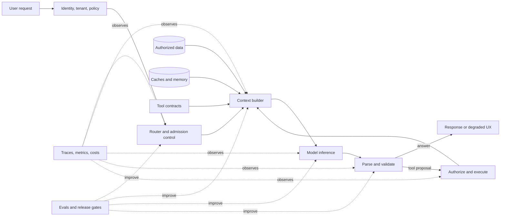

<!-- MARKETING WRAPPER: draft only; not canonical manuscript text -->

> **Free sample: Sections 1–3**  
> A system-level introduction to production AI, harness engineering, and context engineering.

---

<!-- BEGIN CANONICAL SAMPLE -->
# Production AI Engineering Field Guide

Last evidence review: **2026-07-18**

Production AI engineering works as a system. This handbook lays out an operating model that connects the techniques instead of treating them as isolated fixes. The central idea is simple:

> A model can propose an answer or action. The surrounding system decides whether and how it should proceed, and remains responsible for the outcome.

Optimize for a **successful, policy-compliant user outcome that meets service-level objectives (SLOs) for latency and cost**. A prompt or model call is only one part of that outcome.

## 1. The full system



Each layer has a specific job:

| Layer | Primary responsibility | Typical failure |
|---|---|---|
| Product contract | Define success, SLOs, risk, and degraded behavior | Optimizing a proxy that users do not value |
| Harness | Orchestrate state, tools, retries, budgets, and termination | Runaway loops or duplicate side effects |
| Context | Select the smallest high-signal authorized state for this step | Context rot, stale facts, or contamination |
| Retrieval and memory | Supply current, attributable external knowledge | Irrelevant, stale, or unauthorized evidence |
| Model and serving | Produce useful tokens efficiently | Queueing, KV pressure, or quality loss |
| Validation and policy | Turn probabilistic proposals into safe actions | Valid JSON with invalid business meaning |
| Evals and observability | Detect regressions and explain production behavior | Silent quality, cost, or safety drift |

## 2. Harness engineering, not just prompt engineering

Prompt engineering handles the wording and structure of instructions. Context engineering selects and maintains every token supplied for each model step. Harness engineering runs the software system around the model.

| Discipline | Controls | It does not control by itself |
|---|---|---|
| Prompt engineering | Instruction clarity, examples, response guidance | State, permissions, retries, side effects |
| Context engineering | Instructions, history, retrieved evidence, tool definitions, summaries, token allocation | Execution safety or end-to-end termination |
| Harness engineering | State machine, routing, tools, validators, budgets, caches, telemetry, recovery | The model's intrinsic capability ceiling |

A production harness needs to own:

1. **Bind every run.**
   1. Request identity, tenant, authorization, and policy version.
   2. Prompt, tool, schema, model, and retrieval-index versions.
2. **Control execution.**
   1. Deterministic context assembly and compaction.
   2. Model routing and fallback compatibility.
   3. Parse, schema, semantic, and policy validation.
   4. Retry classification and idempotency.
3. **Bound and account for outcomes.**
   1. Time, token, tool, turn, cost, and risk budgets.
   2. Success, refusal, blocked, degraded, and failed terminal states.
   3. Traces, outcome metrics, and cost attribution.

Enforce any rule about safety, money, permissions, or termination in code. A sentence in a system prompt can steer the model, but it cannot serve as a security boundary.

## 3. Context engineering, not long prompts

Treat context as finite working memory with diminishing marginal value. Adding more can increase prefill cost and time while drawing effective attention away from the material that matters. A long context window does not justify loading everything into it.

Build the context in this order:

1. **Invariant contract:** role, hard policies, output/tool protocol, and current schema version.
2. **Current task:** the user's latest intent and explicit constraints.
3. **Authorized state:** only the tenant, resource, and conversation state needed now.
4. **Fresh evidence:** retrieved passages with source, version, timestamp, and access metadata.
5. **Available actions:** only relevant, clearly distinct tool contracts.
6. **Useful history:** compact decisions and unresolved state, not an unfiltered transcript.
7. **Examples:** only when they improve the target eval more than the tokens and anchoring risk cost.

Practical rules:

- Optimize **signal per token**, not context-window utilization.
- Retrieve details just in time. Keep durable decisions in explicit state.
- Label and separate untrusted content from instructions, but do not mistake roles, delimiters, or typed fields for isolation. Enforce a deterministic source-to-sink policy so data derived from an untrusted source cannot authorize actions, expand permissions, or select new egress destinations.
- Keep provenance attached through summarization. A summary without its source and version creates a future stale-fact bug.
- Use structured state instead of repeatedly asking the model to infer state from prose.
- Give tools concise, non-overlapping names and descriptions. Expose only the tools relevant to the current step.
- Version and hash the context manifest so the team can reproduce a bad result.
- Test context ordering and truncation. Models can use relevant information less reliably when it is buried in a long input, a behavior documented by the [Lost in the Middle](https://aclanthology.org/2024.tacl-1.9/) study.

Treat a token budget as a policy, not a universal percentage. One practical version looks like this:

```key-value
fixed contract      hard cap; cache-friendly prefix
task and state      enough to make the current decision
retrieved evidence  top-ranked, deduplicated, attributable
tool definitions    relevant tools only
working history     compacted decisions and open questions
output reserve      protected before adding more input
```

When the budget gets tight, remove redundant and low-confidence material first. Compress authoritative instructions or evidence only after those cuts.

<!-- END CANONICAL SAMPLE -->

---

<!-- MARKETING WRAPPER: draft only; not canonical manuscript text -->

## Continue with the complete field guide

The remaining sections cover cache and inference engineering; structured outputs, tool calling, and agent guardrails; routing, RAG, and evals; observability, cost, safety, failure diagnosis, and production readiness.

The full Production AI Engineering guide is available for `$5/month`. The subscription includes the current PDF, material new editions while active, and one source-reviewed field note every Tuesday.

`Get the complete guide — $5/month`

CTA destination: `{CHECKOUT_URL}`
